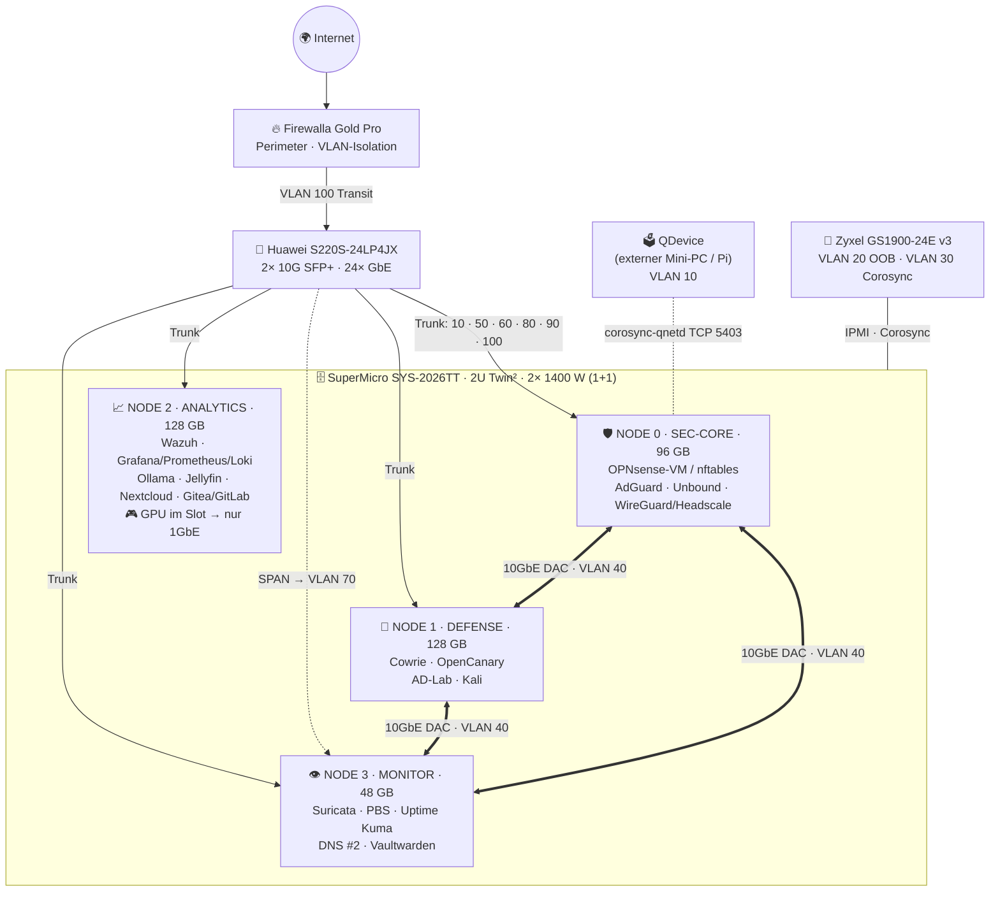

<div align="center">

# 🗄️ Proxmox VE auf einem 2U-4-Node-Cluster

### Warum Proxmox VE auf einem 2U-Twin²-Server die beste Wahl ist – warum Enterprise-Hardware Jahrzehnte hält – und was du darauf alles betreiben kannst

*Ein didaktisches, ehrliches Handbuch am Beispiel eines realen SuperMicro-SYS-2026TT-Clusters (4 Nodes, 8× Xeon L5640, 400 GB DDR3 ECC) in Schaan, Liechtenstein.*


</div>

---

> [!IMPORTANT]
> **Ehrlichkeits-Versprechen:** Dieses Repository verkauft nichts, enthält **keine Affiliate-Links** und hat **keine Verbindung** zu Proxmox Server Solutions, SuperMicro oder anderen Herstellern. Es gibt **keine erfundenen Benchmarks**. Jede Zahl ist entweder eine **Herstellerangabe mit Link** ✅, aus einer **publizierten Studie** ✅ oder **ausdrücklich als ⚠️ Schätzung/Annahme** markiert. Die Referenz-Hardware stammt von **2010 (Intel Westmere)** – wir sagen klar, was sie kann und was **nicht**. Recherchestand: **14. Oktober 2026**. Alle Grenzen stehen gesammelt im [🔍 Reality Check](docs/reality-check.md).

| Marker | Bedeutung |
|---|---|
| ✅ | Durch Primärquelle (Herstellerdoku/-datenblatt, Studie) belegt |
| 🟦 | Durch unabhängige Quelle (Forum, GitHub-Issue, Community) belegt – Einzelmeinung möglich |
| ⚠️ | Unverifiziert, widersprüchlich, eigene Schätzung/Ableitung – **bitte selbst prüfen** |
| ❌ | Trifft laut Quelle **nicht** zu / funktioniert auf dieser Hardware nicht |

> 🤝 **Companion-Repositories:** [node300-net/sovereign-datacenter](https://github.com/node300-net/sovereign-datacenter) (Architektur-Deep-Dive desselben Clusters: ZFS-ARC, VFIO, SDN, nftables) · [node300-net/firewalla-gold-pro-msp](https://github.com/node300-net/firewalla-gold-pro-msp) (Perimeter-Firewall davor). **Dieses Repo** beantwortet die *Warum*-Fragen und liefert einen **Use-Case-Katalog mit Sizing**.

## 📚 Inhaltsverzeichnis

- [🗺️ Repository-Struktur](#️-repository-struktur)
- [⚡ TL;DR](#-tldr)
- [🖥️ Die Referenz-Hardware](#️-die-referenz-hardware)
- [🔀 Abweichungen: Spezifikations-Dokument vs. sovereign-datacenter](#-abweichungen-spezifikations-dokument-vs-sovereign-datacenter)
- [🌐 Node-Rollen & VLANs (Mermaid)](#-node-rollen--vlans)
- [🧩 Welcher Dienst läuft wo?](#-welcher-dienst-läuft-wo)
- [⚡ Quickstart](#-quickstart)
- [📖 Quellen](#-quellen)
- [📜 Lizenz](#-lizenz)

---

## 🗺️ Repository-Struktur

| Pfad | Inhalt |
|---|---|
| [`docs/why-proxmox.md`](docs/why-proxmox.md) | 🧠 Warum Proxmox VE: KVM + LXC, ZFS, Cluster/HA & **Quorum mit 4 Nodes**, Ceph, PBS, Lizenzmodell, API/IaC, Vergleich mit Alternativen |
| [`docs/why-2u4n.md`](docs/why-2u4n.md) | 🗄️ Warum 2U-4-Node (Twin²): Dichte, geteilte redundante Netzteile, Hot-Plug-Nodes, Strom- & Lärm-Trade-offs, gemeinsame Fehlerpunkte |
| [`docs/enterprise-longevity.md`](docs/enterprise-longevity.md) | 🏗️ Warum Enterprise-Hardware Jahrzehnte hält: MTBF/AFR, ECC, Bauteile, IPMI, Ersatzteilmarkt, Firmware – **und ihre ehrlichen Grenzen** |
| [`docs/use-cases.md`](docs/use-cases.md) | 🎯 Use-Case-Katalog (22 Einträge, 25+ Dienste) mit Kurz-How-to, Ressourcen-Sizing & RAM-Budget pro Node |
| [`docs/reality-check.md`](docs/reality-check.md) | 🔍 Alle Plausibilitäts-, Kompatibilitäts-, Strom- und Sicherheitshinweise gesammelt |
| [`configs/`](configs/README.md) | 🧰 Beispiele mit `<<PLATZHALTER>>`: AdGuard-LXC via `pct`, Cowrie (Docker Compose & LXC), OPNsense-VM via `qm`, VLAN-`interfaces`, OpenCanary, QDevice |
| `LICENSE` | MIT (Code/Configs) + CC BY-SA 4.0 (Dokumentation) |
| `CONTRIBUTING.md` | Kurzleitfaden für Beiträge |

---

## ⚡ TL;DR

| 💡 Frage | Kurzantwort | Details |
|---|---|---|
| **Warum Proxmox VE?** | Ein Debian-basiertes System, das **VMs (KVM) und Container (LXC)**, **ZFS**, **Cluster + HA**, **Ceph**, Firewall, SDN und Backup (PBS) in einer Weboberfläche + REST-API vereint – **ohne Lizenzkosten** (AGPLv3). Subscription nur optional für Enterprise-Repo/Support. ✅ | [why-proxmox.md](docs/why-proxmox.md) |
| **Warum 2U-4-Node?** | **4 unabhängige Server** in 2 Höheneinheiten, **gemeinsame redundante Netzteile und Lüfter**, Nodes einzeln ziehbar. Ideal, um **echtes Clustering** (Quorum, HA, Live-Migration) zu lernen und zu betreiben. ✅ | [why-2u4n.md](docs/why-2u4n.md) |
| **Aber: ein Chassis = ein Cluster?** | Ja – Backplane, Lüfter, PSU-Käfig und Stromkreis sind **geteilt**. HA schützt vor **Node**-Ausfall, nicht vor **Chassis**-Ausfall. Backups gehören **ausserhalb**. ⚠️ | [Reality Check](docs/reality-check.md#rc-n1) |
| **Warum hält die Hardware so lange?** | ECC-RAM, Serverbauteile für 24/7, redundante Netzteile, **IPMI**, riesiger **Gebraucht-Ersatzteilmarkt**. Die Hardware von 2010 läuft 2026 noch Proxmox VE 9.2. ✅ | [enterprise-longevity.md](docs/enterprise-longevity.md) |
| **Und die Grenzen?** | **Stromverbrauch**, **Lärm**, **kein AVX/AVX2** (manche Software & Gast-OS ❌), PCIe 2.0, **1 PCIe-Slot pro Node**, kein Firmware-Support mehr. ⚠️ | [Reality Check](docs/reality-check.md) |
| **Was kann ich betreiben?** | Firewall-VM, DNS-Filter, Honeypots, IDS/IPS, SIEM, Monitoring, VPN, Cloud, Passwortmanager, Smart Home, Medienserver, lokale LLMs, Git + CI, AD-/Red-Team-Lab, Backup, IPAM, IaC … | [use-cases.md](docs/use-cases.md) |

---

## 🖥️ Die Referenz-Hardware

> 📄 Quelle: Hardwarespezifikation des Users **„SUPERMICRO 2026TT RED TEAM CLUSTER“**, Dokument-Ref. **SM-2026TT-SPEC-V1**, Standort **Schaan, Liechtenstein**, Status *ACTIVE* (als `.docx` übergeben; inhaltsgleich mit der PDF im Companion-Repo [sovereign-datacenter/docs/reference](https://github.com/node300-net/sovereign-datacenter/tree/main/docs/reference)). Werte unverändert übernommen; Anmerkungen in der rechten Spalte.

### 🧱 Chassis, Power & Storage

| Komponente | Laut Spezifikation | Anmerkung |
|---|---|---|
| **Chassis** | SuperMicro **SYS-2026TT**, 4 unabhängige Einschub-Nodes, 2U, „2U Twin² Architecture“ | SuperMicro: *„Four hot-pluggable systems (nodes) in a 2U form factor“* ✅ ([Datenblatt 2026TT-HIBXRF](https://www.supermicro.com/products/system/2U/2026/SYS-2026TT-HIBXRF.cfm)) |
| **Netzteile** | **2× 1400 W PWS-1K41P-1R** (Platinum), „2800 W max., N+1“ | Real **1+1**: nutzbar ≈ **1'400 W** (bei 230 V). SuperMicro listet für das 2026TT-HIBXRF „Gold Level“ ⚠️ → [RC-1](docs/reality-check.md#rc-1) |
| **Spare-Netzteile** | 2× PWS-1K41P-1R | 👍 Sehr gute Praxis |
| **Drive Bays** | 24× MCP-220-00047-0B (2.5″ SAS/SATA Caddies), **6 pro Node**, „24× frei für 96–192 TB“ | 192 TB ⇒ 8 TB pro 2.5″-Bay ⚠️ → [RC-N2](docs/reality-check.md#rc-n2) |
| **Netzwerk pro Node** | Dual 10Gb SFP+ (**Intel X710**) + Dual 1GbE (**Intel 82574L**) | X710 ist Add-in-Karte im **einzigen** PCIe-Slot → [RC-3](docs/reality-check.md#rc-3) |
| **Summen** | **4 Nodes · 48C/96T · 400 GB · 2'800 W** | 96+128+128+48 = **400 GB** ✅ · 8 × 6 Kerne = 48 ✅ |

### 🧩 Node-Rollen (aus der Spezifikation)

| Node | Rolle | CPU | RAM | Storage | GPU / Beschleuniger | Primäre Rolle |
|---|---|---|---|---|---|---|
| 🛡️ **NODE 0** | **SEC-CORE** – Firewall & VPC Gateway | 2× L5640 (12C/24T @ 2.26 GHz) | **96 GB** (12× 8 GB) | 512 GB Kingston Enterprise SSD | GTX 1080 Ti 11 GB, Kolink-Riser (Phase 2) | nftables Edge, L3/L4-VPC-Filter, Routing |
| 🍯 **NODE 1** | **DEFENSE** – Honeypot & Deception | 2× L5640 | **128 GB** (lt. Spec 16× 8 GB) | 512 GB Kingston Enterprise SSD | ASUS XG Mobile RTX 3080 eGPU via TB5-Adapter (Phase 2) | Cowrie SSH Deception, Credential Trapping |
| 📈 **NODE 2** | **ANALYTICS** – ML & Anomaly Engine | 2× L5640 | **128 GB** (lt. Spec 16× 8 GB) | 2 TB Kingston SSD | RTX 3070 Ti 8 GB (Phase 3, Ziel Weihnachten 2026) | Model Training, Flow-Analyse, Traffic-Baseline |
| 👁️ **NODE 3** | **MONITOR** – Suricata IDS & Logging | 2× L5640 | **48 GB** (6× 8 GB) | 1 TB Seagate Constellation ES HDD | Slot bewusst frei („Kühlungsentlastung“) | Suricata DPI & Syslog Sink |

### 🌐 Umgebung & Roadmap

| Einheit | Modell | Funktion |
|---|---|---|
| 🔥 Edge-Firewall | **Firewalla Gold Pro** | Perimeter, VLAN-Isolation → [Companion-Repo](https://github.com/node300-net/firewalla-gold-pro-msp) |
| 🔀 Core-Switch | **Huawei S220S-24LP4JX** (2× 10G SFP+ + 24× 1GbE) | Cluster-Interconnect & Sync |
| 🧰 Mgmt-Switch | **Zyxel GS1900-24E v3** (24× 1GbE, L2) | Out-of-Band (IPMI) & Monitoring |
| 🎒 Off-Cluster | ASUS ROG Flow X13, RTX 4070 Laptop | Mobile Dev-Station |

| Phase | Inhalt | Status | Budget (lt. Spec) | Ziel |
|---|---|---|---|---|
| 1 | Cat7-Verkabelung, **Proxmox 9.2**, Smart Swiss Socket | ✅ Abgeschlossen | ~171–255 CHF | Sep 2026 |
| 2A/B | TB5-PCIe-Adapter, 2× Kolink-Riser, GPU-Integration | 🟢 Aktiv | 271–281 CHF | Okt 2026 |
| 3 | RTX 3070 Ti, 4× Bulk-SAS/SATA-Disks, 10Gb-DAC-Kabel | 🟡 Planung | 250–400 CHF | Dez 2026 |

> [!WARNING]
> **Stromlast (aus der Spezifikation übernommen):** > **1'200 W Peak** unter Volllast inkl. GPUs. Vor Phase 2/3 Hausinstallation durch eine **Elektrofachkraft** prüfen lassen (10 A/16 A, CEE/T13). Keine provisorischen Stromkabelstränge.

---

## 🔀 Abweichungen: Spezifikations-Dokument vs. sovereign-datacenter

Die `.docx` ist **inhaltlich identisch** mit der PDF `SM-2026TT-SPEC-V1`, auf der [sovereign-datacenter](https://github.com/node300-net/sovereign-datacenter) beruht (gleiche Ref.-Nummer, gleiche Tabellen, gleiche Zahlen). Unterschiede gibt es nur zwischen **Dokument** und **Darstellung im älteren Repo** bzw. **Herstellerangaben**:

| # | Thema | Spezifikation (.docx) | sovereign-datacenter / Hersteller | Bewertung |
|---|---|---|---|---|
| D1 | Kühlung NODE 3 | „GPU-Slot dediziert unbelegt (Kühlungsentlastung)“ – **kein** Wort von „passiv gekühlt“ | README dort: „*passiv gekühlt (wie angegeben)*“ | ⚠️ Im älteren Repo überinterpretiert; hier korrigiert. Alle Nodes haben passive CPU-Kühlkörper + geteilte Chassis-Lüfter ✅ |
| D2 | Hot-Plug | „4 unabhängige Einschub-Nodes“ | dort: „4 hot-plug Nodes“ | ✅ Deckt sich mit SuperMicro („hot-pluggable nodes“) |
| D3 | PSU-Effizienz | „Platinum Level“ | SuperMicro-Datenblatt 2026TT-HIBXRF: **„Gold Level“** 1400 W (1+1) | ⚠️ Hängt vom PSU-Modul ab – Typenschild prüfen ([RC-1](docs/reality-check.md#rc-1)) |
| D4 | RAM-Slots | „16× 8 GB, 2 Slots frei“ ⇒ 18 Slots/Node | SuperMicro: **12 DIMM-Slots**/Node, max. 192 GB | ⚠️ Unverändert übernommen ([RC-6](docs/reality-check.md#rc-6)) |
| D5 | Drive-Kapazität | „24× frei für 96–192 TB“ | 4 Bays sind durch die Boot-SSD/HDD belegt; 2.5″-SATA bei 3 Gb/s | ⚠️ Neu bewertet in [RC-N2](docs/reality-check.md#rc-n2) |
| D6 | OOB | „Out-of-Band **iLO**“ | SuperMicro nutzt **IPMI 2.0** (Nuvoton WPCM450 BMC) | 🟢 Begriff, Funktion identisch ([RC-8](docs/reality-check.md#rc-8)) |
| D7 | Firewall-Rolle | NODE 0: „NFTables Edge“ | dieses Repo zeigt zusätzlich **OPNsense/pfSense-VM** als Alternative | ℹ️ Didaktische Ergänzung, keine Abweichung |
| D8 | Firewalla-Ports | „Gigabit WAN/LAN (25 W)“ | Hersteller bewirbt 10GbE/2.5GbE | ⚠️ Am Gerät prüfen ([RC-11](docs/reality-check.md#rc-11)) |

> 💡 Die bekannten Reality-Check-Punkte aus dem älteren Repo – **1 PCIe-Slot pro Node**, **N+1 ≠ 2'800 W**, **Westmere-Grenzen**, **TB5 auf Westmere**, **GPU-Grösse/-Strom**, **nur 2× SFP+ am Huawei** – gelten **weiterhin** und sind im [Reality Check](docs/reality-check.md) übernommen und um neue Punkte (Quorum im Einzelchassis, x86-64-v3-Gäste, Ceph-Eignung …) ergänzt.

---

## 🌐 Node-Rollen & VLANs



| VLAN | Name | Subnetz (Platzhalter) | Zweck | Wer darf rein? |
|---|---|---|---|---|
| **10** | `MGMT` | `10.10.10.0/24` | Proxmox-GUI (8006), SSH, QDevice | nur Admin-VLAN / VPN |
| **20** | `OOB` | `10.10.20.0/24` | IPMI/BMC – **nie** ins Internet | nur Jumphost |
| **30** | `COROSYNC` | `10.10.30.0/24` | Cluster-Heartbeat, nicht geroutet | intra-VLAN |
| **40** | `STORAGE` | `10.10.40.0/24` | Migration, ZFS-Replikation, (Ceph) | intra-VLAN |
| **50** | `DMZ-HONEY` | `10.10.50.0/24` | Cowrie, OpenCanary | Ingress definierte Ports, **Egress gesperrt** |
| **60** | `LAB-REDTEAM` | `10.10.60.0/24` | AD-Lab, Kali | **kein** Internet, kein MGMT |
| **70** | `SPAN` | – | Mirror-Traffic → Suricata | – |
| **80** | `SERVICES` | `10.10.80.0/24` | Nextcloud, Vaultwarden, Jellyfin, Gitea, HA, Ollama | LAN/VPN nach Regel |
| **90** | `IOT` | `10.10.90.0/24` | Smart-Home-Geräte für Home Assistant | nur zu HA, kein LAN |
| **100** | `WAN-TRANSIT` | `172.16.100.0/29` | Firewalla ↔ OPNsense/NODE 0 | – |

> 💡 **Warum ein Dreieck statt Stern?** Jeder Node hat nur **einen** PCIe-Slot ([RC-3](docs/reality-check.md#rc-3)). Dieses Repo schlägt vor: **GPU-Lasten auf NODE 2** (dort steckt dann die GPU statt der X710), **X710 in N0, N1, N3**. Die je zwei SFP+-Ports bilden per DAC ein **Full-Mesh-Dreieck** für VLAN 40 (Migration/Replikation) – der Huawei hat ohnehin nur 2× SFP+ ([RC-7](docs/reality-check.md#rc-7)). NODE 2 hängt mit 1GbE am Cluster. Das weicht bewusst von der Spec ab (dort: X710 **und** GPU in N0/N1/N2), weil beides physisch nicht gleichzeitig geht.

> ℹ️ VLAN-Nummern 10–70 und 100 sind mit [sovereign-datacenter](https://github.com/node300-net/sovereign-datacenter) kompatibel. **Neu:** VLAN 80 heisst hier `SERVICES` (dort `ANALYTICS`) und VLAN 90 `IOT`. Passe das an deinen Plan an.

---

## 🧩 Welcher Dienst läuft wo?

| Dienst | Typ | Node | VLAN | vCPU | RAM | Disk | GPU |
|---|---|---|---|---|---|---|---|
| 🔥 OPNsense / pfSense | VM | N0 | 100 / Trunk | 4 | 8 GB | 32 GB | – |
| 🛡️ AdGuard Home #1 | LXC | N0 | 10/80 | 1 | 512 MB | 4 GB | – |
| 🔁 Unbound #1 | LXC | N0 | 10/80 | 1 | 512 MB | 2 GB | – |
| 🔐 WireGuard / Headscale (+ Tailscale-Subnet-Router) | LXC | N0 | 10 | 1 | 1 GB | 4 GB | – |
| 🍯 Cowrie | LXC/Docker | N1 | 50 | 1 | 1 GB | 10 GB | – |
| 🐤 OpenCanary | LXC | N1 | 50 / 80 | 1 | 512 MB | 4 GB | – |
| 🏰 AD-/Red-Team-Lab (2 DC + 2 Clients) | VMs | N1 | 60 | 8 | 24 GB | 240 GB | – |
| 🐉 Kali Linux | VM | N1 | 60 | 4 | 8 GB | 60 GB | – |
| 🦉 Wazuh (all-in-one) | VM | N2 | 80 | 8 | 16 GB | 200 GB | – |
| 📊 Grafana + Prometheus + Loki | LXC/VM | N2 | 80 | 4 | 8 GB | 150 GB | – |
| 🤖 Ollama + Open WebUI | VM | N2 | 80 | 8 | 16 GB | 150 GB | RTX 3070 Ti |
| 🎬 Jellyfin / Plex | LXC | N2 | 80 | 4 | 4 GB | 20 GB (+ Medien) | (geteilt, s. [Use-Cases](docs/use-cases.md#jellyfin)) |
| ☁️ Nextcloud | VM/LXC | N2 | 80 | 4 | 6 GB | 50 GB (+ Daten) | – |
| 🏠 Home Assistant OS | VM | N2 | 80/90 | 2 | 4 GB | 32 GB | – |
| 🦊 GitLab CE **oder** 🍵 Gitea/Forgejo | VM/LXC | N2 | 80 | 4 / 2 | 8 GB / 1 GB | 50 / 10 GB | – |
| 🏃 CI-Runner (2×) | LXC/VM | N2 | 80 | 4 | 8 GB | 50 GB | – |
| 🗺️ NetBox | LXC/Docker | N2 | 10 | 2 | 4 GB | 20 GB | – |
| ⚙️ Ansible/Terraform-Controller | LXC | N2 | 10 | 2 | 2 GB | 10 GB | – |
| 👁️ Suricata IDS (IPS optional auf N0) | VM | N3 | 70 + 80 | 6 | 12 GB | 100 GB | – |
| 💾 Proxmox Backup Server | VM | N3 | 40 | 4 | 8 GB | Datastore auf Phase-3-Disks | – |
| 📈 Uptime Kuma | LXC | N3 | 10/80 | 1 | 512 MB | 4 GB | – |
| 🛡️ Pi-hole **oder** AdGuard #2 + Unbound #2 | LXC | N3 | 10/80 | 1 | 1 GB | 6 GB | – |
| 🔑 Vaultwarden | LXC | N3 | 80 | 1 | 512 MB | 4 GB | – |

> ⚠️ Alle Grössen sind **Startwerte (eigene Schätzung)** auf Basis von Hersteller-Mindestanforderungen, wo vorhanden – verlinkt im [Use-Case-Katalog](docs/use-cases.md). Das **RAM-Budget pro Node** (inkl. ZFS-ARC und Host-Reserve) steht dort in [🧮 Budget](docs/use-cases.md#budget).

---

## ⚡ Quickstart

> [!CAUTION]
> Alle Konfigurationen sind **Beispiele mit Platzhaltern** (`<<PLATZHALTER>>`). Nie blind auf Produktivsysteme kopieren. **IPMI-KVM offen halten** – ein Netzwerkfehler sperrt dich sonst aus.

```bash
# 0) Repo holen
git clone https://github.com/node300-net/proxmox-2u4n-cluster.git && cd proxmox-2u4n-cluster

# 1) BIOS jedes Nodes (IPMI-KVM): VT-x + VT-d an; Westmere bootet i. d. R. Legacy/BIOS
# 2) Proxmox VE 9.2 pro Node installieren (Hostnamen: pve-n0 … pve-n3)
# 3) Netzwerk nach configs/network/interfaces.vlan.example → ifreload -a
# 4) Cluster: Corosync link0 = eigener Link (VLAN 30, Zyxel), link1 = Fallback über MGMT (VLAN 10, Huawei)
#    link1 bewusst NICHT über VLAN 40: NODE 2 hat (GPU im Slot) keine X710 – alle Nodes brauchen dieselben Links
pvecm create lab2u4n --link0 10.10.30.10 --link1 10.10.10.10         # auf NODE 0
pvecm add 10.10.30.10 --link0 10.10.30.11 --link1 10.10.10.11        # auf NODE 1 (N2: .12, N3: .13)
# 5) QDevice (empfohlen bei gerader Node-Zahl) → configs/cluster/qdevice-setup.sh
# 6) Erste Dienste:
bash configs/lxc/adguard-lxc.sh        # AdGuard Home als LXC
bash configs/vm/opnsense-vm.sh         # OPNsense-VM
cd configs/docker/cowrie && docker compose up -d   # Cowrie (in einer Docker-LXC/VM auf NODE 1)
```

---

## 📖 Quellen

| Thema | Quelle |
|---|---|
| Proxmox VE 9.2 Release (21.05.2026) | <https://pve.proxmox.com/wiki/Roadmap> · [Pressemitteilung](https://www.proxmox.com/en/about/company-details/press-releases/proxmox-virtual-environment-9-2) |
| Proxmox VE Admin Guide (Cluster, QDevice, HA, ZFS, Ceph, pct, qm) | <https://pve.proxmox.com/pve-docs/pve-admin-guide.html> |
| Proxmox Subscriptions & Preise | <https://www.proxmox.com/en/products/proxmox-virtual-environment/pricing> |
| Proxmox Backup Server | <https://pbs.proxmox.com/docs/> |
| SuperMicro SYS-2026TT-HIBXRF Datenblatt | <https://www.supermicro.com/products/system/2U/2026/SYS-2026TT-HIBXRF.cfm> |
| Intel Xeon L5640 (ARK) | <https://www.intel.com/content/www/us/en/products/sku/47926/intel-xeon-processor-l5640-12m-cache-2-26-ghz-5-86-gts-intel-qpi/specifications.html> |
| DRAM-Fehler im Feld | Schroeder, Pinheiro, Weber: *DRAM Errors in the Wild*, SIGMETRICS 2009 – <https://www.cs.toronto.edu/~bianca/papers/sigmetrics09.pdf> |
| Disk-Ausfallraten | Schroeder & Gibson, USENIX FAST 2007 – <https://www.usenix.org/conference/fast-07/disk-failures-real-world-what-does-mttf-1000000-hours-mean-you> · [Backblaze Drive Stats](https://www.backblaze.com/cloud-storage/resources/hard-drive-test-data) |
| Ollama ohne AVX (GPU-Erkennung) | 🟦 <https://github.com/ollama/ollama/issues/2187> · <https://github.com/ollama/ollama/issues/8683> |
| Weitere Quellen je Dienst | im [Use-Case-Katalog](docs/use-cases.md) und in den einzelnen Kapiteln |

---

## 📜 Lizenz

- 🧑‍💻 **Code & Konfigurationen** (`configs/**`, ausser `*.md`): **MIT** – siehe [LICENSE](LICENSE)
- 📝 **Dokumentation** (`README.md`, `docs/**`, `*.md`): **CC BY-SA 4.0**
- ™️ Proxmox, SuperMicro, Intel, NVIDIA, Firewalla, Huawei, Zyxel u. a. sind Marken ihrer Inhaber. Keine Verbindung, keine Empfehlung durch diese.

<div align="center">

**🗄️ Vier Server. Zwei Höheneinheiten. Null Lizenzkosten. Volle Ehrlichkeit.**

</div>
