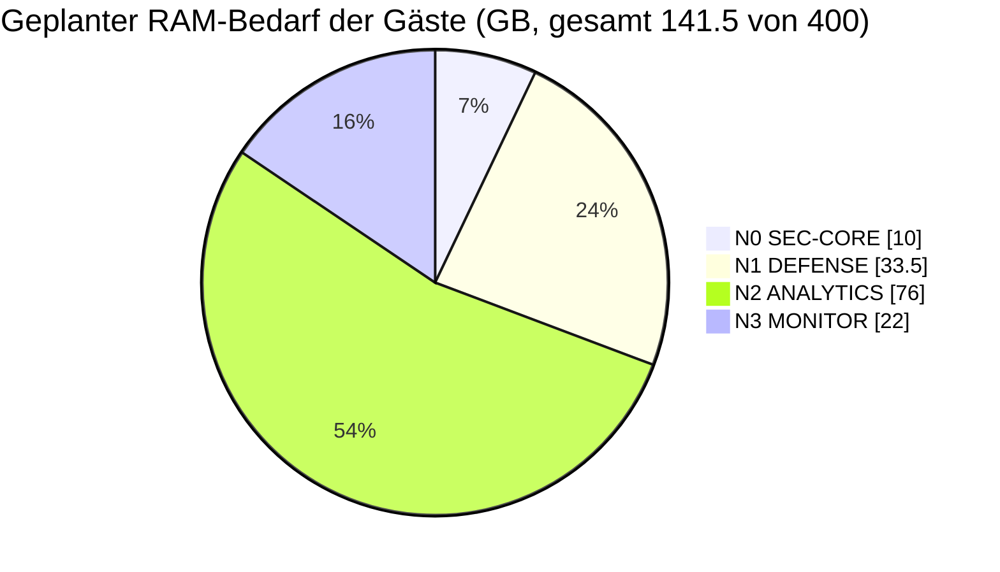

# 🎯 Use-Case-Katalog – was du mit Proxmox VE auf 4 Nodes betreiben kannst

> Zurück zur [README](../README.md) · Vorher: [🏗️ Langlebigkeit](enterprise-longevity.md) · Weiter: [🔍 Reality Check](reality-check.md)

Jeder Eintrag hat: **Wozu?** · **Typ (VM/LXC/Docker)** · **Node** · **Sizing** · **Kurz-How-to** · **Quelle**. Die Sizing-Werte sind **Startwerte** ⚠️ – wo der Hersteller Mindestwerte nennt, ist das verlinkt. Hochskalieren geht in Proxmox mit wenigen Klicks.

> [!CAUTION]
> Befehle enthalten `<<PLATZHALTER>>` (VMIDs, IPs, Storage-Namen, Template-Versionen). Vorlagen-Dateinamen (`pveam available`) ändern sich laufend – **immer prüfen**.

## 📚 Inhalt

| Kategorie | Dienste |
|---|---|
| 🔥 Netzwerk & Perimeter | [OPNsense/pfSense](#-firewall-vm-opnsense--pfsense) · [AdGuard Home](#️-adguard-home-lxc) · [Pi-hole](#pi-hole) · [Unbound](#-unbound-rekursiver-dns) · [WireGuard/Tailscale/Headscale](#-wireguard--tailscale--headscale) |
| 🍯 Deception & Detection | [Cowrie](#-cowrie-ssh-honeypot) · [OpenCanary](#-opencanary) · [Suricata](#️-suricata-ids--ips) · [Wazuh](#-wazuh-siem--xdr) |
| 📊 Betrieb & Observability | [Grafana/Prometheus/Loki](#-grafana--prometheus--loki) · [Uptime Kuma](#-uptime-kuma) · [NetBox](#️-netbox) · [Ansible/Terraform](#️-ansible--terraform) · [PBS](#-proxmox-backup-server) |
| ☁️ Self-Hosting | [Nextcloud](#️-nextcloud) · [Vaultwarden](#-vaultwarden) · [Home Assistant](#-home-assistant) · [Jellyfin/Plex](#jellyfin) · [Ollama](#-ollama--lokale-llms-gpu) · [GitLab/Gitea + CI](#gitlab-gitea) |
| 🏰 Offensive Lab | [Active Directory / Red-Team-Lab](#-active-directory--red-team-lab) · [Kali Linux](#-kali-linux) |
| 🧮 Planung | [RAM-/CPU-Budget pro Node](#budget) |

---

## 🔥 Netzwerk & Perimeter

### 🔥 Firewall-VM (OPNsense / pfSense)

| | |
|---|---|
| **Wozu?** | Interne Firewall/Router **zwischen den Lab-VLANs** (50/60/80/90) hinter der Firewalla Gold Pro; IDS-Plugins, VPN, DHCP, DNS-Weiterleitung |
| **Typ / Node** | **VM** (FreeBSD) auf **NODE 0** (SEC-CORE) |
| **Sizing** | 4 vCPU · 8 GB RAM · 32 GB Disk · virtio-NIC an VLAN-aware `vmbr0` (Trunk) + VLAN 100 Transit |
| **Hersteller-Minimum** | OPNsense: siehe [Hardware-Anforderungen](https://docs.opnsense.org/manual/hardware.html) ✅ |
| **Alternative** | Spezifikation sieht auf NODE 0 **nftables direkt** vor → Beispiel in [sovereign-datacenter/configs/nftables](https://github.com/node300-net/sovereign-datacenter/tree/main/configs/nftables) |

**Kurz-How-to:** ISO nach `local:iso/` laden → [`configs/vm/opnsense-vm.sh`](../configs/vm/opnsense-vm.sh) ausführen → Konsole: Interfaces zuweisen (`vtnet0` = WAN/Transit, `vtnet1` = LAN-Trunk) → VLANs in *Interfaces ▸ Other Types ▸ VLAN* anlegen.

> ⚠️ **Ehrlich:** Firewalla **und** OPNsense = zwei Firewalls hintereinander. Das ist für ein Lab sinnvoll (Perimeter vs. Segmentierung), bedeutet aber **doppelte Regelpflege**. Vermeide **doppeltes NAT**: Firewalla routet VLAN 100 → OPNsense **ohne** NAT, statische Routen für die Lab-Netze. Die Firewall-VM ist ein **Single Point of Failure** – mit HA + Replikation auf einen zweiten Node absichern oder bewusst akzeptieren.

### 🛡️ AdGuard Home (LXC)

| | |
|---|---|
| **Wozu?** | DNS-Filter (Werbung, Tracker, Malware-Domains), DoH/DoT, Statistik pro Client |
| **Typ / Node** | **unprivilegierter LXC** (Debian 13) auf **NODE 0**, zweite Instanz auf **NODE 3** |
| **Sizing** | 1 vCPU · 512 MB · 4 GB |
| **Quelle** | [AdGuard Home Wiki/GitHub](https://github.com/AdguardTeam/AdGuardHome) ✅ |

**Kurz-How-to:** [`configs/lxc/adguard-lxc.sh`](../configs/lxc/adguard-lxc.sh) (legt LXC per `pct create` an und installiert AdGuard Home) → Web-Setup auf `http://<<IP>>:3000` → Upstream auf **Unbound** (`127.0.0.1:5335` bzw. Unbound-LXC) setzen → DHCP (OPNsense/Firewalla) verteilt **beide** DNS-Server.

<a id="pi-hole"></a>

### 🕳️ Pi-hole (Alternative)

| | |
|---|---|
| **Wozu?** | Wie AdGuard Home; grosse Community, sehr ausgereift |
| **Typ / Node** | LXC auf **NODE 3** (statt AdGuard #2) |
| **Sizing** | 1 vCPU · 512 MB–1 GB · 4 GB |
| **Quelle** | [docs.pi-hole.net](https://docs.pi-hole.net/) ✅ |

**Kurz-How-to:** Debian-LXC anlegen (wie AdGuard, anderer Hostname) → offizielles Installationsskript laut Doku → Upstream = Unbound. **Entweder** Pi-hole **oder** AdGuard pro Instanz – zwei unterschiedliche Filter mit unterschiedlichen Listen verwirren beim Debugging.

| Kriterium | AdGuard Home | Pi-hole |
|---|---|---|
| DoH/DoT/DoQ eingebaut | ✅ | ⚠️ über Zusatzdienste |
| Einzelnes Binary | ✅ (Go) | ❌ (mehrere Komponenten) |
| Community/Listen | gross | sehr gross |

### 🔁 Unbound (rekursiver DNS)

| | |
|---|---|
| **Wozu?** | Fragt **selbst** die Root-/TLD-Server – kein Upstream-Anbieter sieht alle deine Anfragen; DNSSEC-Validierung |
| **Typ / Node** | LXC auf **NODE 0** + **NODE 3** (oder im selben LXC wie AdGuard/Pi-hole) |
| **Sizing** | 1 vCPU · 512 MB · 2 GB |
| **Quelle** | [unbound.docs.nlnetlabs.nl](https://unbound.docs.nlnetlabs.nl/) ✅ |

```bash
apt install unbound
cat > /etc/unbound/unbound.conf.d/lab.conf <<'CONF'
server:
    interface: 0.0.0.0
    port: 5335
    access-control: 10.10.0.0/16 allow
    access-control: 0.0.0.0/0 refuse
    hide-identity: yes
    hide-version: yes
    prefetch: yes
CONF
systemctl restart unbound && dig @127.0.0.1 -p 5335 proxmox.com +dnssec
```

### 🔐 WireGuard / Tailscale / Headscale

| | |
|---|---|
| **Wozu?** | Sicherer Fernzugriff auf MGMT-VLAN (Proxmox-GUI, IPMI-Jumphost) ohne Ports für die GUI zu öffnen |
| **Typ / Node** | LXC auf **NODE 0**; alternativ direkt auf OPNsense (WireGuard-Plugin) oder auf der Firewalla |
| **Sizing** | 1 vCPU · 512 MB–1 GB · 4 GB |
| **Quellen** | [wireguard.com](https://www.wireguard.com/) ✅ · [Tailscale Subnet Router](https://tailscale.com/kb/1019/subnets) ✅ · [Headscale](https://github.com/juanfont/headscale) 🟦 (Community-Projekt, selbst gehosteter Tailscale-Control-Server) |

| Variante | Vorteil | Nachteil |
|---|---|---|
| **WireGuard pur** | Minimal, im Kernel, keine Drittpartei | 1 UDP-Port offen, Schlüsselverwaltung manuell |
| **Tailscale** | NAT-Traversal, kein offener Port, SSO | Control-Plane beim Anbieter |
| **Headscale** | Tailscale-Clients, aber Control-Plane **selbst** gehostet | Eigenbetrieb, nicht alle Tailscale-Features |

> ⚠️ WireGuard in einem **LXC** nutzt das Kernelmodul des **Hosts** (Proxmox-Kernel enthält es). Für `tailscaled` im unprivilegierten LXC braucht es `/dev/net/tun` – siehe Kommentar in [`configs/lxc/adguard-lxc.sh`](../configs/lxc/adguard-lxc.sh) (Abschnitt TUN).

---

## 🍯 Deception & Detection

### 🍯 Cowrie (SSH-Honeypot)

| | |
|---|---|
| **Wozu?** | Medium-Interaction-Honeypot für SSH/Telnet: zeichnet Logins, Befehle und Downloads von Angreifern auf |
| **Typ / Node** | Docker in einer **VM** oder einem **unprivilegierten LXC mit Nesting** auf **NODE 1**, VLAN 50 |
| **Sizing** | 1 vCPU · 1 GB · 10 GB |
| **Quelle** | [github.com/cowrie/cowrie](https://github.com/cowrie/cowrie) · [Doku](https://docs.cowrie.org/) ✅ |

**Kurz-How-to:** [`configs/docker/cowrie/docker-compose.yml`](../configs/docker/cowrie/docker-compose.yml) oder [`configs/lxc/cowrie-lxc.sh`](../configs/lxc/cowrie-lxc.sh) → Cowrie lauscht auf **2222/2223** → auf OPNsense/Firewalla **Port 22 → 2222** per Port-Forward/DNAT → JSON-Logs (`cowrie.json`) an Wazuh/Loki.

> 🔴 **Egress sperren!** Ein Honeypot, der ins Internet darf, wird zur Angriffsplattform. VLAN 50: **nur** eingehend definierte Ports, **ausgehend nur** Log-Ziel (Syslog/Loki) erlaubt.

### 🐤 OpenCanary

| | |
|---|---|
| **Wozu?** | Low-Interaction-„Stolperdraht“: täuscht FTP/HTTP/SMB/RDP/MySQL/SNMP u. a. vor und **alarmiert** bei jedem Zugriff – ideal **im internen LAN** |
| **Typ / Node** | LXC auf **NODE 1**, ein Interface im **SERVICES-/LAN-VLAN** (nicht nur DMZ!) |
| **Sizing** | 1 vCPU · 512 MB · 4 GB |
| **Quelle** | [github.com/thinkst/opencanary](https://github.com/thinkst/opencanary) · [Doku](https://opencanary.readthedocs.io/) ✅ |

**Kurz-How-to:** `apt install python3-venv build-essential libssl-dev libffi-dev` → `python3 -m venv /opt/oc && /opt/oc/bin/pip install opencanary` → Konfig [`configs/opencanary/opencanary.conf.example`](../configs/opencanary/opencanary.conf.example) nach `/etc/opencanaryd/opencanary.conf` → `opencanaryd --start`. Alarme per Syslog/Webhook/SMTP. Vergleich mit kommerziellen Lösungen: [stingbox-explained](https://github.com/node300-net/stingbox-explained).

### 👁️ Suricata (IDS / IPS)

| | |
|---|---|
| **Wozu?** | Netzwerk-IDS mit Signaturen (ET Open), Protokoll-Logs (DNS, TLS, HTTP), `eve.json` |
| **Typ / Node** | **VM** auf **NODE 3** (MONITOR); zweites Interface am **SPAN-VLAN 70** (Huawei Port-Mirror) |
| **Sizing** | 6 vCPU · 12 GB · 100 GB (Logs) |
| **Quelle** | [docs.suricata.io](https://docs.suricata.io/) ✅ |

**Kurz-How-to:** VM (Debian/Ubuntu) mit zwei NICs: `net0` VLAN 80 (Mgmt/Logs), `net1` an Bridge mit Mirror-Traffic → `apt install suricata` → `af-packet` auf `net1`, `HOME_NET` = `10.10.0.0/16` → `suricata-update` → `eve.json` an Wazuh/Loki.

| Modus | Wo | Bewertung |
|---|---|---|
| **IDS** (passiv, SPAN) | NODE 3 | ✅ Risikoarm: fällt Suricata aus, fliesst der Traffic weiter |
| **IPS** (inline) | Auf OPNsense (NODE 0, Plugin) | ⚠️ Fehlalarme blockieren echten Traffic; CPU der Westmere-Kerne limitiert den Durchsatz |

> 💡 Suricata nutzt für schnelles Pattern-Matching **Hyperscan/Vectorscan**, das **SSSE3** benötigt – Westmere hat SSSE3 und SSE4.2 ✅, also kein AVX-Problem.

### 🦉 Wazuh (SIEM / XDR)

| | |
|---|---|
| **Wozu?** | Zentrales SIEM: Agenten auf Hosts, Log-Analyse (Cowrie, Suricata, OPNsense), FIM, Schwachstellen-Erkennung, Dashboard |
| **Typ / Node** | **VM** (Ubuntu 24.04) auf **NODE 2** |
| **Sizing** | Laut [Wazuh-Quickstart](https://documentation.wazuh.com/current/quickstart.html) ✅: **4 vCPU / 8 GiB / 50 GB** für 1–25 Agenten, 8 vCPU / 8 GiB / 100–200 GB bis 100 Agenten. Hier: **8 vCPU · 16 GB · 200 GB** (Reserve, weil Westmere-Kerne langsamer sind ⚠️) |

**Kurz-How-to:** `curl -sO https://packages.wazuh.com/4.14/wazuh-install.sh && sudo bash ./wazuh-install.sh -a` (Version im Link laut aktueller Doku prüfen) → Agenten auf den Gästen ausrollen → Suricata-`eve.json` und Cowrie-JSON als Log-Quellen einbinden.

> ⚠️ Wazuh nennt u. a. **RHEL 10 / CentOS Stream 10** als empfohlene OS – diese setzen **x86-64-v3** voraus und **starten auf Westmere nicht**. Ubuntu 24.04 nehmen. → [RC-N3](reality-check.md#rc-n3)

---

## 📊 Betrieb & Observability

### 📊 Grafana + Prometheus + Loki

| | |
|---|---|
| **Wozu?** | Metriken (Proxmox, IPMI-Sensoren, Node-Exporter), Logs (Syslog, Cowrie, Suricata), Dashboards & Alerts |
| **Typ / Node** | LXC oder VM mit Docker auf **NODE 2** (SSD) |
| **Sizing** | 4 vCPU · 8 GB · 150 GB (Retention bestimmt Disk!) |
| **Quellen** | [Grafana](https://grafana.com/docs/) · [Prometheus](https://prometheus.io/docs/) · [Loki](https://grafana.com/docs/loki/latest/) ✅ · [prometheus-pve-exporter](https://github.com/prometheus-pve/prometheus-pve-exporter) 🟦 |

**Kurz-How-to:** Proxmox hat einen eingebauten **Metric Server** (Datacenter ▸ Metric Server: InfluxDB/Graphite) ✅ – **oder** `prometheus-pve-exporter` mit API-Token (Rolle `PVEAuditor`). Zusätzlich `ipmi_exporter` für Temperaturen/Lüfter/PSU → Alert bei Lüfterausfall.

### 📈 Uptime Kuma

| | |
|---|---|
| **Wozu?** | Einfaches Uptime-Monitoring (HTTP, TCP, DNS, Ping) mit Statusseite und Benachrichtigungen |
| **Typ / Node** | LXC (Docker oder Node.js) auf **NODE 3** |
| **Sizing** | 1 vCPU · 512 MB · 4 GB |
| **Quelle** | [github.com/louislam/uptime-kuma](https://github.com/louislam/uptime-kuma) ✅ |

**Kurz-How-to:** `docker run -d --restart=unless-stopped -p 3001:3001 -v uptime-kuma:/app/data --name uptime-kuma louislam/uptime-kuma:<<VERSION>>` → Checks für Proxmox-GUI (8006), DNS (53), OPNsense, Nextcloud …

> ⚠️ Ein Monitor **im selben Chassis** meldet nicht, wenn das **ganze Chassis** ausfällt. Zusätzlich einen externen Check (z. B. zweite Kuma-Instanz auf einem Pi/VPS oder Firewalla-Benachrichtigung) einrichten.

### 🗺️ NetBox

| | |
|---|---|
| **Wozu?** | „Source of Truth“ für IPs, VLANs, Racks, Kabel, Geräte – dokumentiert dieses ganze Repo als Datenbank |
| **Typ / Node** | LXC/VM mit Docker auf **NODE 2** |
| **Sizing** | 2 vCPU · 4 GB · 20 GB |
| **Quelle** | [netboxlabs.com/docs/netbox](https://netboxlabs.com/docs/netbox/) ✅ · [netbox-docker](https://github.com/netbox-community/netbox-docker) 🟦 |

**Kurz-How-to:** `git clone -b release https://github.com/netbox-community/netbox-docker.git && cd netbox-docker` → `docker compose up -d` → VLANs 10–100 und Prefixe aus der [README](../README.md#-node-rollen--vlans) anlegen → später Ansible/Terraform daraus speisen.

### ⚙️ Ansible / Terraform

| | |
|---|---|
| **Wozu?** | Reproduzierbare Infrastruktur: Gäste per Code anlegen, Konfiguration vereinheitlichen |
| **Typ / Node** | Kleiner Controller-LXC auf **NODE 2** (oder Admin-Workstation) |
| **Sizing** | 2 vCPU · 2 GB · 10 GB |
| **Quellen** | [bpg/proxmox Provider](https://registry.terraform.io/providers/bpg/proxmox/latest/docs) 🟦 · [community.proxmox](https://docs.ansible.com/ansible/latest/collections/community/proxmox/index.html) ✅ · Beispiele: [sovereign-datacenter/configs](https://github.com/node300-net/sovereign-datacenter/tree/main/configs) |

**Kurz-How-to:** API-Token anlegen (siehe [why-proxmox.md](why-proxmox.md#-api--infrastructure-as-code)) → `terraform init && terraform plan` → State-Dateien **nie** committen (enthalten Secrets; siehe [`.gitignore`](../.gitignore)).

### 💾 Proxmox Backup Server

| | |
|---|---|
| **Wozu?** | Deduplizierte, inkrementelle, verschlüsselte Backups aller VMs/LXCs |
| **Typ / Node** | **VM** auf **NODE 3**, Datastore auf den **Phase-3-Bulk-Disks** (Passthrough der Disks oder ZFS-Pool) |
| **Sizing** | 4 vCPU · 8 GB · Datastore nach Bedarf. PBS-Doku: mind. 4 GiB + ca. 1 GiB pro TiB Datastore ✅ ([PBS-Systemanforderungen](https://pbs.proxmox.com/docs/installation.html#system-requirements)) |

**Kurz-How-to:** PBS-ISO als VM installieren → Datastore anlegen → in PVE *Datacenter ▸ Storage ▸ Add ▸ Proxmox Backup Server* (Fingerprint!) → Backup-Job nachts, **Verify-Job** wöchentlich → **Sync-Job** zu einem zweiten Ziel ausserhalb des Chassis.

---

## ☁️ Self-Hosting

### ☁️ Nextcloud

| | |
|---|---|
| **Wozu?** | Eigene Cloud: Dateien, Kalender, Kontakte, Office (Collabora/OnlyOffice) |
| **Typ / Node** | VM (z. B. Nextcloud AIO in Docker) oder LXC auf **NODE 2** |
| **Sizing** | 4 vCPU · 6 GB · 50 GB System + Daten-Disk |
| **Quelle** | [Nextcloud Admin Manual – Systemanforderungen](https://docs.nextcloud.com/server/latest/admin_manual/installation/system_requirements.html) ✅ · [Nextcloud AIO](https://github.com/nextcloud/all-in-one) ✅ |

**Kurz-How-to:** Docker-VM → Nextcloud AIO laut README starten → Reverse-Proxy mit gültigem Zertifikat → Daten-Disk separat, damit PBS-Backups planbar bleiben.

> ⚠️ Office-Server (Collabora/OnlyOffice) sind CPU-hungrig; auf Westmere mit Geduld rechnen.

### 🔑 Vaultwarden

| | |
|---|---|
| **Wozu?** | Bitwarden-kompatibler Passwortserver (schlanke Rust-Implementierung) |
| **Typ / Node** | LXC mit Docker auf **NODE 3** |
| **Sizing** | 1 vCPU · 512 MB · 4 GB |
| **Quelle** | [github.com/dani-garcia/vaultwarden](https://github.com/dani-garcia/vaultwarden) ✅ (inoffiziell, nicht von Bitwarden Inc.) |

**Kurz-How-to:** `docker run -d --name vaultwarden -v /vw-data/:/data/ -p 127.0.0.1:8080:80 vaultwarden/server:latest` → Reverse-Proxy mit **HTTPS** (Web-Vault braucht einen sicheren Kontext) → Registrierung nach Anlage der Konten deaktivieren (`SIGNUPS_ALLOWED=false`) → **nicht** öffentlich exponieren, Zugriff via VPN.

### 🏠 Home Assistant

| | |
|---|---|
| **Wozu?** | Smart-Home-Zentrale, lokal statt Cloud |
| **Typ / Node** | **VM mit Home Assistant OS** auf **NODE 2**, NIC in VLAN 80 + VLAN 90 (IoT) |
| **Sizing** | 2 vCPU · 4 GB · 32 GB (HA-Doku nennt für VMs mind. 2 GB RAM / 32 GB Disk ✅ [Installation – Linux/KVM](https://www.home-assistant.io/installation/linux)) |

**Kurz-How-to:** qcow2-Image laden → `qm disk import <<VMID>> haos_ova-<<VER>>.qcow2 local-zfs` → **UEFI (OVMF)** als BIOS setzen → booten. USB-Sticks (Zigbee/Z-Wave) per USB-Passthrough durchreichen.

> ⚠️ **Ehrlich:** Hot-Plug/HA-Migration bricht bei **USB-Passthrough** – der Stick steckt physisch an **einem** Node. Alternative: Netzwerk-Koordinator (Zigbee über Ethernet).

<a id="jellyfin"></a>

### 🎬 Jellyfin / Plex (mit GPU)

| | |
|---|---|
| **Wozu?** | Medienserver mit Hardware-Transcoding |
| **Typ / Node** | **LXC** auf **NODE 2** mit NVIDIA-Device-Bind (GPU teilbar mit anderen LXCs) **oder** VM mit exklusivem Passthrough |
| **Sizing** | 4 vCPU · 4 GB · 20 GB + Medien (NFS/SMB oder Daten-Disk) |
| **Quellen** | [Jellyfin – NVIDIA HWA](https://jellyfin.org/docs/general/post-install/transcoding/hardware-acceleration/nvidia/) ✅ · [Plex HW-Transcoding](https://support.plex.tv/articles/115002178853-using-hardware-accelerated-streaming/) ✅ (Plex: nur mit **Plex Pass**) |

**Kurz-How-to (LXC-Weg):** NVIDIA-Treiber **auf dem Host** installieren → im LXC dieselbe Treiberversion **ohne Kernelmodul** (`--no-kernel-module`) → Devices `/dev/nvidia0`, `/dev/nvidiactl`, `/dev/nvidia-uvm` per `dev0:`-Einträgen in `/etc/pve/lxc/<<CTID>>.conf` → in Jellyfin *NVENC* aktivieren.

| GPU (Spec) | NVENC-Encode | Hinweis |
|---|---|---|
| GTX 1080 Ti (Pascal) | H.264, HEVC | ❌ kein AV1. Treiber: **R580 ist der letzte Branch für Pascal**, ab Okt. 2025 nur noch Sicherheitsupdates bis Okt. 2028 ✅ ([NVIDIA](https://nvidia.custhelp.com/app/answers/detail/a_id/5676/~/support-plan-for-maxwell%2C-pascal%2C-and-volta-series-geforce-gpus)) |
| RTX 3070 Ti (Ampere) | H.264, HEVC | AV1 nur **Decode**, nicht Encode |

> ⚠️ Mit **VM-Passthrough** ist die GPU **exklusiv** – Ollama und Jellyfin können sie dann nicht gleichzeitig nutzen. Der LXC-Weg erlaubt Teilen, bindet Host-Treiber und Container-Treiber aber an **dieselbe Version** (Updates koordinieren!).

### 🤖 Ollama / lokale LLMs (GPU)

| | |
|---|---|
| **Wozu?** | Lokale Sprachmodelle (Zusammenfassen von Logs, Chat, Code) ohne Cloud – z. B. mit **Open WebUI** |
| **Typ / Node** | **VM mit GPU-Passthrough** oder LXC mit Device-Bind auf **NODE 2** (RTX 3070 Ti, Phase 3) |
| **Sizing** | 8 vCPU · 16 GB RAM · 150 GB (Modelle) · **VRAM ist der Engpass**: 8 GB (3070 Ti) / 11 GB (1080 Ti) |
| **Quellen** | [ollama.com](https://ollama.com/) · [Ollama GPU-Support](https://docs.ollama.com/gpu) ✅ · AVX-Thema: [#2187](https://github.com/ollama/ollama/issues/2187), [#8683](https://github.com/ollama/ollama/issues/8683) 🟦 |

**Kurz-How-to:** GPU-Passthrough vorbereiten (VFIO-Anleitung: [sovereign-datacenter/configs/vfio](https://github.com/node300-net/sovereign-datacenter/tree/main/configs/vfio)) → in der VM NVIDIA-Treiber + `curl -fsSL https://ollama.com/install.sh | sh` → `ollama run <<MODELL>>` → Startmeldung prüfen: wird die GPU erkannt?

> ⚠️ **Westmere ohne AVX:** Ältere Ollama-Builds haben die GPU auf CPUs **ohne AVX** komplett deaktiviert („CPU does not have AVX or AVX2, disabling GPU support“). Laut Maintainer wurde das Anfang 2025 durch dynamische Backends behoben 🟦 – **im Log verifizieren**. Ohne GPU ist reine CPU-Inferenz auf diesen Kernen **sehr langsam**. Modelle müssen weitgehend **komplett in den VRAM** passen; Faustregel ⚠️: 7–8B-Modelle in 4-Bit-Quantisierung für 8 GB VRAM.

> ⚠️ **PCIe 2.0** (~8 GB/s auf x16, via Riser ggf. weniger) verlängert das **Laden** der Modelle; die Inferenz selbst läuft danach im VRAM.

<a id="gitlab-gitea"></a>

### 🦊 GitLab / 🍵 Gitea + CI-Runner

| | |
|---|---|
| **Wozu?** | Eigene Git-Plattform für Configs/IaC (z. B. dieses Repo), CI-Pipelines (Linting, `terraform plan`, Ansible-Checks) |
| **Typ / Node** | GitLab CE: **VM** · Gitea/Forgejo: **LXC** · Runner: LXC/VM – alle auf **NODE 2** |
| **Sizing** | GitLab: 4 vCPU · 8 GB · 50 GB ([Anforderungen](https://docs.gitlab.com/install/requirements/) ✅) · Gitea: 2 vCPU · 1 GB · 10 GB · Runner: je 2 vCPU · 4 GB |
| **Quellen** | [docs.gitlab.com](https://docs.gitlab.com/) · [docs.gitea.com](https://docs.gitea.com/) · [forgejo.org](https://forgejo.org/) ✅ |

| | GitLab CE | Gitea / Forgejo |
|---|---|---|
| Ressourcen | 🐘 schwer | 🪶 sehr leicht |
| CI | GitLab CI eingebaut | Gitea/Forgejo Actions (GitHub-Actions-ähnlich) |
| Empfehlung hier | wenn GitLab-Wissen das Lernziel ist | ✅ für ein Homelab meist die bessere Wahl |

> ⚠️ CI-Runner mit Docker-in-Docker: lieber in einer **VM** statt in einem privilegierten LXC (Container-Ausbruch = Host-Zugriff).

---

## 🏰 Offensive Lab

### 🏰 Active Directory / Red-Team-Lab

| | |
|---|---|
| **Wozu?** | AD-Angriffe & -Verteidigung üben: Kerberoasting, ACL-Missbrauch, Lateral Movement, Detection mit Wazuh |
| **Typ / Node** | **VMs** auf **NODE 1**, **VLAN 60** (kein Internet, kein MGMT) |
| **Sizing** | 2 DCs (je 2 vCPU · 4 GB · 60 GB) + 2 Clients (je 2 vCPU · 8 GB · 60 GB) = **8 vCPU · 24 GB · 240 GB** |
| **Quellen** | [Windows Server Evaluation](https://www.microsoft.com/en-us/evalcenter) ✅ · [GOAD – Game of Active Directory](https://github.com/Orange-Cyberdefense/GOAD) 🟦 (bietet Proxmox-Provider) |

**Kurz-How-to:** Eval-ISOs + [virtio-win-ISO](https://pve.proxmox.com/wiki/Windows_VirtIO_Drivers) → VM mit `ostype win11`, **vTPM + OVMF** für Windows 11 → Snapshot nach Grundinstallation (**„Golden Image“**) → Lab per GOAD/Ansible ausrollen → nach jeder Übung auf Snapshot zurück.

> ⚠️ **Windows 11** prüft eine **CPU-Kompatibilitätsliste**, auf der Westmere nicht steht; der Installer kann das blockieren. Windows Server bzw. Windows 10 sind im Lab unproblematischer. CPU-Typ der VM: `x86-64-v2-AES` (Proxmox-Default) passt zu Westmere ✅.

### 🐉 Kali Linux

| | |
|---|---|
| **Wozu?** | Angreifer-Workstation im Lab-VLAN |
| **Typ / Node** | **VM** auf **NODE 1**, VLAN 60 (optional zweites Interface in 50 für Honeypot-Tests) |
| **Sizing** | 4 vCPU · 8 GB · 60 GB |
| **Quelle** | [kali.org – Virtualisierung](https://www.kali.org/docs/virtualization/) ✅ |

**Kurz-How-to:** Kali-ISO oder vorgefertigtes QEMU-Image → `qm create` (siehe Muster in [`configs/vm/opnsense-vm.sh`](../configs/vm/opnsense-vm.sh)) → `qemu-guest-agent` installieren → **Snapshot** vor jeder Übung.

> 🔴 **Recht & Ethik:** Angriffswerkzeuge nur gegen **eigene** Systeme oder mit schriftlicher Erlaubnis einsetzen. VLAN 60 hat **keinen** Weg in produktive Netze.

---

<a id="budget"></a>

## 🧮 RAM- & CPU-Budget pro Node

> ⚠️ Eigene Planung. **ARC** = ZFS-Lese-Cache (begrenzt per `zfs_arc_max`), **Host** = Reserve für Proxmox selbst. vCPUs dürfen überbucht werden (Faustregel ⚠️: bis ~2–3× bei Lab-Lasten), **RAM nicht**.

| Node | RAM | Gäste (Summe RAM) | ARC | Host | Belegt | **Frei** | vCPU (Summe) / Threads | Bemerkung |
|---|---|---|---|---|---|---|---|---|
| 🛡️ N0 | 96 GB | OPNsense 8 · AdGuard 0.5 · Unbound 0.5 · VPN 1 = **10 GB** | 4 GB | 4 GB | 18 GB | **~78 GB** | 7 / 24 | Bewusst schlank. Freier RAM = **HA-Reserve** – aber nur für Gäste derselben Vertrauensstufe |
| 🍯 N1 | 128 GB | Cowrie 1 · OpenCanary 0.5 · AD-Lab 24 · Kali 8 = **33.5 GB** | 4 GB | 4 GB | ~42 GB | **~86 GB** | 14 / 24 | Platz für grössere Labs (z. B. GOAD-Varianten mit mehr VMs) |
| 📈 N2 | 128 GB | Wazuh 16 · Monitoring 8 · Ollama 16 · Jellyfin 4 · Nextcloud 6 · HA 4 · GitLab 8 · Runner 8 · NetBox 4 · IaC 2 = **76 GB** | 8 GB | 4 GB | 88 GB | **~40 GB** | 42 / 24 | ⚠️ ~1.75× CPU-Überbuchung – mit **Gitea** statt GitLab sinkt es deutlich |
| 👁️ N3 | 48 GB | Suricata 12 · PBS 8 · Kuma 0.5 · DNS #2 1 · Vaultwarden 0.5 = **22 GB** | 4 GB | 4 GB | 30 GB | **~18 GB** | 13 / 24 | Kleinster Node, langsamste Disk (HDD) |



> 💡 **HA-Planung:** Fällt **NODE 2** aus (76 GB Gäste), passen dessen Gäste nicht komplett auf N3 (18 GB frei), wohl aber verteilt auf **N0 + N1**. Lege in *Datacenter ▸ HA ▸ Rules* fest, **welche** Gäste wohin dürfen – Wazuh auf dem Firewall-Node ist z. B. akzeptabel, ein Honeypot dort nicht.
