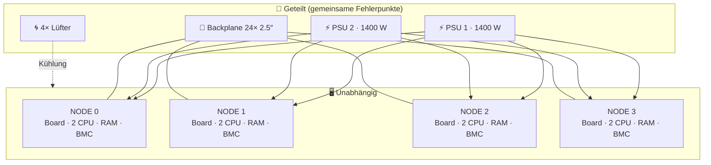

# 🗄️ Warum ein 2U-4-Node-Server (Twin²)?

> Zurück zur [README](../README.md) · Vorher: [🧠 Warum Proxmox](why-proxmox.md) · Weiter: [🏗️ Langlebigkeit](enterprise-longevity.md)

Ein **2U-4-Node-System** (SuperMicro nennt die Bauform **Twin²**) packt **vier komplette Server** – je eigenes Mainboard, eigene CPUs, eigener RAM, eigene NICs, eigenes BMC – in **ein 2-HE-Gehäuse**. Geteilt werden nur **Netzteile, Lüfter, Gehäuse und die Disk-Backplane**.

## 🔩 Aufbau des SYS-2026TT (Herstellerangaben)

| Merkmal | SuperMicro-Datenblatt (2026TT-HIBXRF) ✅ | Bedeutung |
|---|---|---|
| Nodes | **4 hot-pluggable systems (nodes)** in 2U | Ein Node kann im laufenden Betrieb gezogen werden – die anderen drei laufen weiter |
| Mainboard | 4× X8DTT-HIBXF+ (Intel 5520, ICH10R) | Vier völlig getrennte Rechner |
| CPU | 2× LGA1366 pro Node (Xeon 5500/5600, 40–95 W) | Hier: 2× L5640 (60 W TDP laut [Intel ARK](https://www.intel.com/content/www/us/en/products/sku/47926/intel-xeon-processor-l5640-12m-cache-2-26-ghz-5-86-gts-intel-qpi/specifications.html)) |
| RAM | **12 DIMM-Slots**, bis 192 GB DDR3 ECC REG pro Node | → 768 GB im Chassis möglich |
| PCIe | **1× x16 Low-Profile** pro Node (Riser RSC-R1U-E16R) | ⚠️ Der Engpass schlechthin → [RC-3](reality-check.md#rc-3) |
| Disks | **6× 2.5″ Hot-Swap-SATA** pro Node (24 gesamt) | ICH10R, 3 Gb/s |
| Netzwerk | 2× Intel 82574L GbE + **dedizierter IPMI-Port** pro Node | Je nach SKU zusätzlich onboard InfiniBand (QSFP) |
| Netzteile | **1400 W (1+1) redundant**, PMBus; 1100 W bei 100–140 V, 1400 W bei 180–240 V | Ein Netzteil darf ausfallen |
| Lüfter | **4× PWM-Lüfter** für alle Nodes gemeinsam | Front-to-Back-Luftstrom |
| Masse | 88 × 438 × **679 mm**, Bruttogewicht **38.6 kg** | Tiefes Rack + Schienen nötig |
| Betriebstemperatur | **10–35 °C** | Kein Dachboden im Sommer |

Quelle: [SuperMicro SYS-2026TT-HIBXRF](https://www.supermicro.com/products/system/2U/2026/SYS-2026TT-HIBXRF.cfm). ⚠️ Die Spezifikation nennt nur „SYS-2026TT“ ohne SKU-Suffix – Details (InfiniBand ja/nein, PSU-Modell) können je Variante abweichen.

---

## ✅ Die Vorteile

| Vorteil | Erklärung | Warum gut für Proxmox |
|---|---|---|
| 📦 **Dichte** | 4 Server, 8 Sockel, bis 768 GB RAM in **2 HE** | Ein echter 4-Node-Cluster passt in ein kleines Rack oder einen tiefen Schrank |
| ⚡ **Geteilte, redundante Netzteile** | 2 PSUs versorgen alle 4 Nodes; statt 8 Netzteilen (4× 1U mit je 2) nur 2 | Weniger Teile, weniger Leerlaufverluste, PSU-Ausfall ≠ Downtime |
| 🔥 **Hot-Plug-Nodes** | Node herausziehen, RAM/Disk tauschen, wieder einschieben | Perfekt mit **Live-Migration**: Gäste wegmigrieren → Node ziehen → zurück |
| 🔥 **Hot-Swap-Disks** | 6 Bays pro Node von vorne | Disk-Tausch ohne Abschalten |
| 🧰 **IPMI pro Node** | Eigener BMC mit KVM-over-LAN, Virtual Media, Sensoren | Neuinstallation ohne Monitor/Tastatur |
| 🔌 **Weniger Kabel** | 2 Stromkabel statt 4–8 | Aufgeräumt, weniger Fehlerquellen |
| 🎓 **Echtes Clustering lernen** | Quorum, Fencing, HA, Replikation, Ceph – auf echter Hardware | Wissen 1:1 übertragbar auf Rechenzentren |
| 💰 **Gebrauchtpreis** | Ältere Twin²-Systeme sind als Gebrauchtware oft günstig ⚠️ (Marktpreise schwanken) | Viel RAM pro Franken |

---

## ⚖️ Die Trade-offs (ehrlich)

| Nachteil | Erklärung | Gegenmassnahme |
|---|---|---|
| 🔴 **Ein Chassis = gemeinsamer Fehlerpunkt** | Backplane, PSU-Käfig, Lüfter, Stromkreis | Backup **ausserhalb**; QDevice extern; für Echt-HA zweites Chassis/Standort |
| 🔊 **Lärm** | 4 Lüfter für 8 CPUs + Disks, kleine Durchmesser, hohe Drehzahl ⚠️ | Nicht im Wohn-/Schlafraum; Keller, Abstellraum, Schallschutzschrank mit ausreichend Zuluft |
| ⚡ **Strom** | 8 Sockel + Chipsätze laufen 24/7 | Ungenutzte Nodes per IPMI ausschalten; messen statt schätzen (s. u.) |
| 🧩 **1 PCIe-Slot pro Node** | 10GbE **oder** GPU **oder** HBA | Rollen so verteilen, dass jeder Node nur **eine** Karte braucht ([RC-3](reality-check.md#rc-3)) |
| 📐 **Low-Profile, 1U-Höhe pro Node** | Keine Full-Height/Dual-Slot-GPUs im Node | GPU extern per Riser + eigenes Netzteil ([RC-2](reality-check.md#rc-2)) |
| 🌡️ **Thermisch gekoppelt** | Ein Node ohne Abdeckung/Blende stört den Luftstrom **aller** | Blenden, Air-Shrouds, Blanks in leeren Bays |
| 🏋️ **Gewicht/Tiefe** | ~39 kg brutto, ~68 cm tief | Schienen, tiefes Rack, zu zweit heben |

### ⚡ Stromkosten – rechne selbst

> ⚠️ **Keine gemessenen Werte.** Die Spezifikation nennt nur **> 1'200 W Peak** (inkl. GPUs). Leerlauf-/Durchschnittswerte unten sind **Annahmen** zur Illustration. Miss mit Messsteckdose und `ipmitool dcmi power reading` (falls vom BMC unterstützt).

**Formel:** `kWh/Jahr = Watt × 8'760 h ÷ 1'000` · `Kosten = kWh × Tarif`

| Annahme Durchschnittslast | kWh/Jahr | bei 0.28 CHF/kWh ⚠️ |
|---|---|---|
| 300 W (wenig Last, ohne GPU) | 2'628 | ≈ 736 CHF |
| 450 W (typischer Lab-Betrieb) | 3'942 | ≈ 1'104 CHF |
| 700 W (mit GPU-Last zeitweise) | 6'132 | ≈ 1'717 CHF |

> 💡 Der Tarif 0.28 CHF/kWh ist ein **Platzhalter** – setze deinen echten Tarif ein. Der grösste Hebel ist meist nicht das Chassis, sondern **GPUs unter Last** und **Nodes, die nichts tun**.

### 🆚 Vergleich der Bauformen (qualitativ)

| Kriterium | **2U-4-Node** | 4× 1U-Server | 4× Mini-PC | 1× grosser 2-Sockel-Server |
|---|---|---|---|---|
| Höheneinheiten | **2** | 4 | 0 (Regal) | 2 |
| Netzteile | 2 (geteilt, redundant) | 4–8 | 4 externe, nicht redundant | 2 |
| ECC / IPMI | ✅ / ✅ | ✅ / ✅ | meist ❌ / ❌ (teils vPro) | ✅ / ✅ |
| Echter Cluster (Quorum, HA) | ✅ | ✅ | ✅ | ❌ (nur 1 Node) |
| Chassis-SPOF | ⚠️ ja | ✅ nein | ✅ nein | ⚠️ ja |
| Lärm | 🔊🔊🔊 | 🔊🔊🔊 | 🔇 | 🔊🔊 |
| Strom pro Leistung (alt vs. neu) | ⚠️ schlecht (2010) | je nach Generation | ✅ gut | je nach Generation |
| RAM pro Franken (gebraucht) | ✅ sehr gut | ✅ | ⚠️ begrenzt (meist ≤ 64–96 GB/Gerät) | ✅ |

**🏁 Fazit:** Die 2U-4-Node-Bauform ist der **kompakteste Weg zu einem echten Proxmox-Cluster mit Server-Features** (ECC, IPMI, Hot-Swap, redundante PSUs). Man erkauft das mit **Lärm, Strom und einem gemeinsamen Chassis** – Punkte, die man **planen** statt ignorieren sollte.
