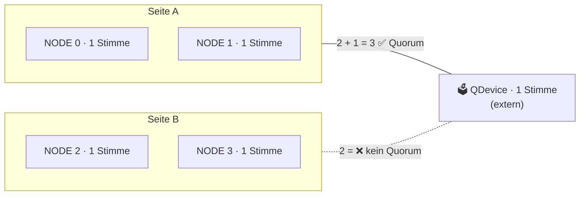

# 🧠 Warum Proxmox VE?

> Zurück zur [README](../README.md) · Weiter: [🗄️ Warum 2U-4-Node](why-2u4n.md) · [🔍 Reality Check](reality-check.md)

Proxmox Virtual Environment (PVE) ist eine **Debian-basierte Virtualisierungsplattform** der Proxmox Server Solutions GmbH (Wien). Aktuell: **Proxmox VE 9.2** (21. Mai 2026) auf **Debian 13.5 „Trixie“**, Kernel 7.0, QEMU 11.0, LXC 7.0, ZFS 2.4, Ceph Squid 19.2 / Tentacle 20.2 ✅ ([Roadmap](https://pve.proxmox.com/wiki/Roadmap)).

> 🎓 **Merksatz:** Proxmox VE ist kein „neues“ Produkt, sondern ein sehr gut integriertes Bündel aus bewährten Open-Source-Bausteinen – **KVM/QEMU, LXC, ZFS, Corosync, Ceph** – mit einer gemeinsamen Weboberfläche, CLI und REST-API.

## 📚 Inhalt

1. [KVM + LXC: zwei Werkzeuge in einem](#-kvm--lxc-zwei-werkzeuge-in-einem)
2. [ZFS: Dateisystem und Volume-Manager](#-zfs-dateisystem-und-volume-manager)
3. [Cluster, Quorum & HA mit 4 Nodes](#️-cluster-quorum--ha-mit-4-nodes)
4. [Ceph: verteilter Speicher (ehrlich bewertet)](#-ceph-verteilter-speicher-ehrlich-bewertet)
5. [Proxmox Backup Server](#-proxmox-backup-server-pbs)
6. [Keine Lizenzkosten – was kostet es wirklich?](#-keine-lizenzkosten--was-kostet-es-wirklich)
7. [API & Infrastructure as Code](#-api--infrastructure-as-code)
8. [Vergleich mit Alternativen](#️-vergleich-mit-alternativen)

---

## 🧱 KVM + LXC: zwei Werkzeuge in einem

| | 🖥️ **KVM/QEMU-VM** | 📦 **LXC-Container** |
|---|---|---|
| Was ist es? | Vollständige virtuelle Maschine mit eigenem Kernel | Isolierte Linux-Umgebung, **teilt den Host-Kernel** |
| Gast-OS | Linux, Windows, BSD (OPNsense!), … | **nur Linux** |
| Overhead | Höher (eigener Kernel, emulierte/virtio-Hardware) | Sehr gering – ideal für kleine Dienste |
| Isolation | Stark (Hardware-Virtualisierung) | Schwächer (gemeinsamer Kernel) – **unprivileged** nutzen ✅ |
| PCIe-Passthrough | ✅ (VFIO, z. B. GPU, NIC) – **exklusiv** für eine VM | ❌ kein echtes Passthrough, aber **Device-Bind** (z. B. `/dev/dri`, `/dev/nvidia*`) – mehrere Container können **eine GPU teilen** |
| Live-Migration | ✅ (online) | ⚠️ nur „Restart Migration“ (Container wird kurz gestoppt) |
| Gute Beispiele hier | OPNsense, Windows-DCs, Kali, Wazuh, Home Assistant OS, Suricata | AdGuard, Unbound, Vaultwarden, Uptime Kuma, Jellyfin, Gitea |

> 💡 **Faustregel:** *Fremder Kernel, Windows/BSD, Angriffsfläche oder Passthrough → VM. Kleiner Linux-Dienst → unprivilegierter LXC.* Honeypots (Cowrie) sind ein Grenzfall: bewusst angreifbare Dienste gehören **eher in eine VM** oder mindestens in einen **unprivilegierten** LXC in einem isolierten VLAN.

Quelle: [PVE Admin Guide – Linux Container](https://pve.proxmox.com/pve-docs/pve-admin-guide.html#chapter_pct) · [Qemu/KVM](https://pve.proxmox.com/pve-docs/pve-admin-guide.html#chapter_virtual_machines) ✅

---

## 💾 ZFS: Dateisystem und Volume-Manager

ZFS ist im Proxmox-Installer direkt wählbar ✅. Was es für **diesen** Cluster bringt:

| Feature | Nutzen | Hier konkret |
|---|---|---|
| 🧮 **Prüfsummen** auf allen Blöcken | Erkennt stille Datenkorruption (Bitrot) | Zusammen mit **ECC-RAM** eine durchgehende Integritätskette |
| 📸 **Snapshots** (CoW) | Sekundenschneller Rückweg vor Updates | Vor jedem OPNsense-/Wazuh-Upgrade |
| 🔁 **`zfs send/recv`** → PVE **Storage Replication** (`pvesr`) | Asynchrone Kopie einer VM-Disk auf andere Nodes | Grundlage für **HA ohne Shared Storage** |
| 🗜️ **Kompression** (lz4/zstd) | Weniger I/O, mehr Platz | Sinnvoll auf der 1-TB-HDD (NODE 3) |
| 🧠 **ARC** (RAM-Cache) | Schnelles Lesen | ⚠️ Konkurriert mit VM-RAM → `zfs_arc_max` begrenzen (Details: [sovereign-datacenter/architecture](https://github.com/node300-net/sovereign-datacenter/blob/main/docs/architecture.md)) |

> ⚠️ **Ehrlich:** Jeder Node hat laut Spezifikation **nur eine** Datendisk. ZFS auf einer Einzeldisk **erkennt** Fehler, kann sie aber **nicht reparieren** (keine Redundanz). Erst die Phase-3-Disks (4× Bulk SAS/SATA) erlauben Mirrors. Bis dahin: **Replikation + Backup** statt RAID.

---

## 🗳️ Cluster, Quorum & HA mit 4 Nodes

Proxmox nutzt **Corosync** für Mitgliedschaft und Nachrichten sowie das Cluster-Dateisystem **pmxcfs** (`/etc/pve`). Damit kein „Split Brain“ entsteht, darf nur die Seite mit **Quorum** (absolute Mehrheit der Stimmen) schreiben und HA-Dienste starten ✅ ([Admin Guide – Cluster Manager](https://pve.proxmox.com/pve-docs/pve-admin-guide.html#chapter_pvecm)).

### 🧮 Die Quorum-Mathematik

> **Quorum = ⌊Stimmen / 2⌋ + 1**

| Szenario | Stimmen gesamt | Quorum | 1 Node weg | 2 Nodes weg | Split 2 ↔ 2 |
|---|---|---|---|---|---|
| 3 Nodes | 3 | 2 | ✅ quorate | ❌ | – |
| **4 Nodes** | 4 | **3** | ✅ quorate | ❌ **kein Quorum** | ❌ **beide Hälften ohne Quorum** |
| **4 Nodes + QDevice** | 5 | **3** | ✅ | ✅ (2 Nodes + QDevice) | ✅ die Seite mit QDevice-Stimme bleibt aktiv |
| 5 Nodes | 5 | 3 | ✅ | ✅ | – |

> 🎓 **Didaktischer Kern:** Ein 4. Node erhöht die Kapazität, **aber nicht die Ausfalltoleranz** gegenüber 3 Nodes – beide überleben genau **einen** Ausfall. Erst eine **externe Zusatzstimme (QDevice)** macht aus 4 Nodes einen Cluster, der **zwei** Ausfälle bzw. einen 2:2-Split übersteht.

Proxmox unterstützt QDevices ausdrücklich für Cluster mit **gerader** Node-Zahl und rät bei ungerader Zahl davon ab ✅ ([Admin Guide – Corosync External Vote Support](https://pve.proxmox.com/pve-docs/pve-admin-guide.html#_corosync_external_vote_support)). Der QDevice-Dienst (`corosync-qnetd`) läuft auf einem **externen** Gerät (Raspberry Pi, Mini-PC, VM auf anderer Hardware) – **nicht** auf einem der 4 Nodes. Beispiel: [`configs/cluster/qdevice-setup.sh`](../configs/cluster/qdevice-setup.sh).



### 🔁 HA in der Praxis

| Baustein | Was er tut | Voraussetzung |
|---|---|---|
| **HA-Manager** (`ha-manager`) | Startet HA-Gäste auf einem anderen Node neu, wenn einer ausfällt | Quorum, ≥ 3 Stimmen ✅ |
| **Fencing** (Watchdog) | Ein Node ohne Quorum startet sich selbst neu, bevor andere seine Gäste übernehmen | Standardmässig Software-Watchdog (`softdog`), alternativ IPMI-Watchdog ✅ |
| **Shared oder replizierter Speicher** | Der neue Node muss die Disk sehen | Ceph/NFS **oder** ZFS-Replikation (`pvesr`) |
| **CRS** (Cluster Resource Scheduler) | Wählt Ziel-Node; ab **PVE 9.2 dynamisches Load-Balancing** ✅ | – |
| **Disarm/Arm HA** (neu in 9.2) | Wartungsfenster ohne Fencing-Risiko ✅ | – |

> ⚠️ **Ehrlich zu ZFS-Replikation + HA:** Replikation ist **asynchron** (kleinstes Intervall: 1 Minute). Fällt ein Node aus, startet der Gast auf dem Ziel mit dem **Stand der letzten Replikation** – Daten seit dem letzten Lauf sind verloren. Für eine Firewall-VM meist egal, für eine Datenbank nicht.

> 🔴 **Und das Wichtigste:** Alle 4 Nodes stecken im **selben Chassis** an **denselben Netzteilen** und **demselben Stromkreis**. HA schützt hier vor **Node-, Board-, RAM- oder Disk-Ausfall** – **nicht** vor Chassis-, PSU-Käfig- oder Stromausfall. → [RC-N1](reality-check.md#rc-n1)

---

## 🐙 Ceph: verteilter Speicher (ehrlich bewertet)

Ceph ist in Proxmox voll integriert (Installation per GUI, `pveceph`) ✅. Es verteilt Daten über alle Nodes (typisch **3 Kopien**) und liefert **echten Shared Storage** – HA ohne Datenverlust-Fenster.

| Kriterium | Empfehlung (Proxmox/Ceph) | Dieser Cluster | Bewertung |
|---|---|---|---|
| Nodes | ≥ 3 ✅ | 4 | ✅ |
| Netz | Dediziert, **≥ 10 GbE** (Proxmox empfiehlt für schnelle Disks deutlich mehr) ✅ | X710 konkurriert mit GPU um den **einzigen** PCIe-Slot; Huawei hat nur 2× SFP+ | ⚠️ / ❌ |
| OSDs | Mehrere pro Node, Enterprise-SSDs mit PLP | 1 Datendisk/Node (Phase 3: +4 Disks gesamt), SATA **3 Gb/s** | ⚠️ |
| RAM | ca. **4 GiB pro OSD** (`osd_memory_target`-Default) + MON/MGR | Reichlich vorhanden (96–128 GB) – N3 mit 48 GB knapp | ✅ |
| Kapazität | 3 Replikate ⇒ **nutzbar ≈ ⅓ brutto** | ⚠️ wenig Platz für viel Aufwand | ⚠️ |

**➡️ Empfehlung:** Für den Alltag **ZFS lokal + Replikation + PBS**. Ceph als **Lernprojekt** (z. B. Ceph Tentacle 20.2 auf den Phase-3-Disks, über das 10G-DAC-Netz), nicht als Fundament. Quelle: [Admin Guide – Deploy Hyper-Converged Ceph](https://pve.proxmox.com/pve-docs/pve-admin-guide.html#chapter_pveceph) ✅

---

## 💾 Proxmox Backup Server (PBS)

| Feature | Erklärung |
|---|---|
| **Inkrementell + dedupliziert** | Nur geänderte Chunks werden übertragen/gespeichert ✅ |
| **Client-seitige Verschlüsselung** | AES-256-GCM – der Backup-Server sieht nur Chiffrat ✅ |
| **Verify-Jobs & Prune/GC** | Prüft Backups regelmässig auf Lesbarkeit |
| **Sync-Jobs / Remotes** | Zweiter PBS (offsite) zieht oder bekommt die Daten – Basis für **3-2-1** |
| **Live-Restore & File-Restore** | VM starten, während sie zurückgespielt wird; einzelne Dateien aus Backups |

> ⚠️ **Ehrlich:** PBS als VM auf NODE 3 ist **bequem**, aber das Backup liegt dann **im selben Chassis**. Mindestens ein **Sync-Job auf ein zweites Ziel** (externe Box, anderer Standort, oder Removable Datastore auf USB) ist Pflicht. Quelle: [PBS-Doku](https://pbs.proxmox.com/docs/) ✅

---

## 💰 Keine Lizenzkosten – was kostet es wirklich?

Proxmox VE ist **Open Source (GNU AGPLv3)** ✅. **Alle Funktionen** – HA, Live-Migration, Ceph, SDN, Backup – sind **ohne** Subscription verfügbar ✅ ([Preise](https://www.proxmox.com/en/products/proxmox-virtual-environment/pricing)). Eine Subscription bringt Zugang zum **Enterprise-Repository** (stärker getestete Updates) und je nach Stufe **Support-Tickets**.

| Stufe (Stand 14.10.2026) | Preis pro CPU-Sockel/Jahr | Für diesen Cluster (8 Sockel) |
|---|---|---|
| **No-Subscription-Repo** | **0 €** | **0 €** ✅ |
| Community | 120 € | 960 €/Jahr |
| Basic | 370 € | 2'960 €/Jahr |
| Standard | 550 € | 4'400 €/Jahr |
| Premium | 1'100 € | 8'800 €/Jahr |

> 💡 Für ein Homelab/Security-Lab reicht das **No-Subscription-Repository** völlig (es zeigt einen Hinweisdialog beim Login – das ist Absicht und legitim). Proxmox verlangt: alle Nodes eines Clusters **gleiche Stufe**, wenn man eine kauft ✅. Preise netto, ohne MwSt.

---

## 🤖 API & Infrastructure as Code

Alles, was die Weboberfläche kann, geht über die **REST-API** (`/api2/json`) bzw. `pvesh` ✅. Authentifizierung über **API-Tokens** mit eigenem Rechte-Set (Privilege Separation).

| Werkzeug | Zweck | Beispiel |
|---|---|---|
| `pvesh` | API auf der CLI | `pvesh get /cluster/resources --type vm` |
| `qm` / `pct` | VMs / Container | [`configs/vm/opnsense-vm.sh`](../configs/vm/opnsense-vm.sh), [`configs/lxc/adguard-lxc.sh`](../configs/lxc/adguard-lxc.sh) |
| **Terraform / OpenTofu** | Deklarative VMs, LXCs, Netze | 🟦 Community-Provider [`bpg/proxmox`](https://registry.terraform.io/providers/bpg/proxmox/latest/docs) |
| **Ansible** | Konfiguration, auch Gäste anlegen | 🟦 Collection [`community.proxmox`](https://docs.ansible.com/ansible/latest/collections/community/proxmox/index.html) (früher Teil von `community.general`) |
| **cloud-init** | Gäste beim ersten Start konfigurieren | Templates + `qm set --ipconfig0 …` ✅ |
| Beispiel-Code | Terraform & Ansible für diesen Cluster | [sovereign-datacenter/configs](https://github.com/node300-net/sovereign-datacenter/tree/main/configs) |

```bash
# API-Token für Terraform (minimal, eigene Rolle) – Platzhalter ersetzen
pveum role add TerraformProv -privs "VM.Allocate VM.Config.Disk VM.Config.CPU VM.Config.Memory VM.Config.Network VM.Config.Options VM.Config.Cloudinit VM.PowerMgmt Datastore.AllocateSpace Datastore.Audit SDN.Use"
pveum user add terraform@pve
pveum aclmod / -user terraform@pve -role TerraformProv
pveum user token add terraform@pve <<TOKEN_NAME>> --privsep 0
```

> ⚠️ Rechte-Namen können sich zwischen Versionen ändern – `pveum role list` und die [Doku zu Benutzerrechten](https://pve.proxmox.com/pve-docs/pve-admin-guide.html#chapter_user_management) prüfen.

---

## ⚖️ Vergleich mit Alternativen

| Kriterium | **Proxmox VE** | VMware vSphere/ESXi | Microsoft Hyper-V | XCP-ng | Unraid |
|---|---|---|---|---|---|
| Lizenz | AGPLv3, 0 € | Proprietär, Abo (Broadcom) ⚠️ | Teil von Windows Server (kostenpflichtig) | Open Source (GPLv2) | Proprietär, Kauf-/Abo-Lizenz ⚠️ |
| VMs + Container | ✅ KVM + LXC | VMs (Container via Tanzu/Zusatz) | VMs (+ Windows-Container) | VMs | VMs + Docker |
| Cluster/HA eingebaut | ✅ | ✅ (vCenter nötig) | ✅ (Failover Cluster) | ✅ (Xen Orchestra) | ❌ |
| ZFS integriert | ✅ | ❌ | ❌ | ⚠️ (Zusatz) | ✅ (seit 6.12) |
| Hyperkonvergenter Speicher | ✅ Ceph | vSAN (Lizenz) | Storage Spaces Direct (Datacenter-Edition) | XOSTOR | ❌ |
| Läuft auf Westmere 2010? | ✅ (PVE 9.2 getestet laut Spec, Phase 1) | ❌ Aktuelle ESXi-Versionen unterstützen diese CPU-Generation nicht ⚠️ | ⚠️ Windows Server 2025 setzt SSE4.2/POPCNT voraus – Westmere hat beides; offiziell nicht zertifiziert | ✅ (64-bit + VT-x) | ✅ |

> ⚠️ Die Zeilen zu Mitbewerbern sind **Kurzfassungen** zum Recherchestand und keine vollständige Bewertung; Lizenzbedingungen (insb. Broadcom/VMware) ändern sich häufig – vor Entscheidungen beim Hersteller prüfen.

**🏁 Fazit:** Für **4 alte, aber RAM-starke Nodes** ohne Budget für Lizenzen ist Proxmox VE die naheliegendste Wahl: **eine** Plattform für VMs **und** Container, **eingebaute** Cluster-/HA-/Backup-Funktionen und eine **API**, die das Ganze reproduzierbar macht.
